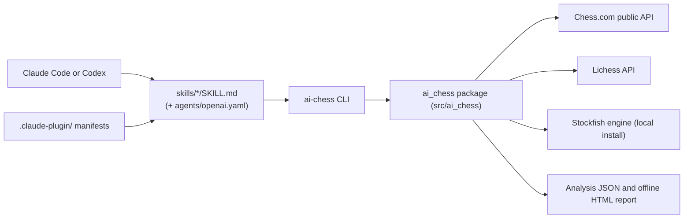

# ai-chess-skills

[](https://github.com/RurociagDanych/ai-chess-skills/actions/workflows/ci.yml)

Agent skills for Claude Code and Codex that fetch chess games, run Stockfish analysis and build offline HTML reports through a tested Python CLI.

The skills (`SKILL.md` contracts) are thin wrappers over the stable `ai-chess` CLI; all executable behavior lives in the agent-neutral `ai_chess` package: a CLI, Chess.com and Lichess clients, Stockfish integration, a CI smoke test, and a Claude Code plugin manifest.

## Status

Active. Last substantive change: 2026-06-16.

## Architecture



One source tree ships for Claude Code and Codex:

- `skills/<name>/SKILL.md` — instructions (read by both agents).
- `skills/<name>/agents/openai.yaml` — Codex interface metadata (checked by `scripts/validate_skill.py`).
- `.claude-plugin/` — Claude Code plugin and marketplace manifests.

### Skills

| Skill | Purpose |
| --- | --- |
| `fetch-chess-games` | Retrieve Chess.com or Lichess games, or import local PGNs into a source archive. |
| `setup-chess-engine` | Inspect and install an official Stockfish build in a user-writable location. |
| `analyze-chess-games` | Analyze a game or archive with Stockfish into schema-valid JSON. |
| `visualize-chess-analysis` | Build a self-contained offline interactive HTML report. |
| `review-chess-game` | Run a one-shot review (engine setup, game retrieval, Stockfish analysis, HTML report) from a single request. |

### CLI contract

```text
ai-chess setup-engine [--plan-only | --approve-download] [--install-dir PATH]
ai-chess fetch chesscom USER --month YYYY-MM [--output-dir DIR] [--user-agent UA]
ai-chess fetch chesscom USER --from YYYY-MM --to YYYY-MM [--output-dir DIR]
ai-chess fetch lichess USER [--max N] [--output-dir DIR] [--user-agent UA]
ai-chess import PATH.pgn [--output-dir DIR]
ai-chess analyze game PATH.pgn [--game N] [--depth 16] [--deep-depth 22]
ai-chess analyze archive PATH.pgn --output ANALYSIS.json
ai-chess review url GAME_URL [--output-dir DIR] [--user-agent UA]
ai-chess report ANALYSIS.json --output report.html [--insights NOTES.txt]
ai-chess doctor
```

## Quick start

Install the Python package (Python 3.13):

```bash
uv pip install -e ".[dev]"   # or: python -m pip install -e ".[dev]"
ai-chess doctor              # verify the CLI is on PATH
```

### Use with Claude Code

The repository root is a Claude Code plugin; the five skills are auto-discovered
from `skills/`. Install it from the bundled marketplace:

```text
/plugin marketplace add /path/to/ai-chess-skills
/plugin install ai-chess-skills@ai-chess-skills
```

Skills then appear namespaced, e.g. `/ai-chess-skills:fetch-chess-games`, and
Claude can also invoke them automatically when a request matches their
description. Each skill pre-approves only the `ai-chess` subcommands it needs via
`allowed-tools`, so the CLI runs without extra permission prompts once you trust
the workspace.

When working inside this repo directly (rather than installing the plugin), the
same skills are also available because the plugin is discovered in place.

### Use with Codex

Each skill keeps its `agents/openai.yaml` interface block. Reference a skill in a
prompt with `$fetch-chess-games`, `$setup-chess-engine`, `$analyze-chess-games`,
`$visualize-chess-analysis`, or `$review-chess-game`.

## Configuration

No `.env` file is used. Optional environment variable:

| Variable | Purpose |
| --- | --- |
| `AI_CHESS_USER_AGENT` | Default HTTP User-Agent for `fetch` and `review` when `--user-agent` is not passed |

## Testing

```bash
pytest --cov=ai_chess --cov-report=term-missing
```

Validate the skills:

```bash
python scripts/validate_skill.py
```

This checks each `SKILL.md` (Claude frontmatter + Codex `openai.yaml`) and the
`.claude-plugin/` manifests. To validate Claude Code packaging end-to-end, also
run `claude plugin validate` against the repo root.

CI (`.github/workflows/ci.yml`) runs both on every push and pull request; `.github/workflows/stockfish-smoke.yml` runs a weekly `ai-chess setup-engine --plan-only` smoke test.

## Deployment

Not deployed; local only. Install the package locally and add the repository as a Claude Code plugin marketplace or use the skills from Codex.

## Known gaps

- No linter or formatter is configured in `pyproject.toml`.
- CI does not run `claude plugin validate`; Claude Code packaging is only checked by `scripts/validate_skill.py`.
- No `docs/` directory: there is no architecture, operations or security document beyond this README and AGENTS.md.
- No release workflow: the package is not published, only installed from source.

## License

GPL-3.0-or-later, see [LICENSE](LICENSE).
